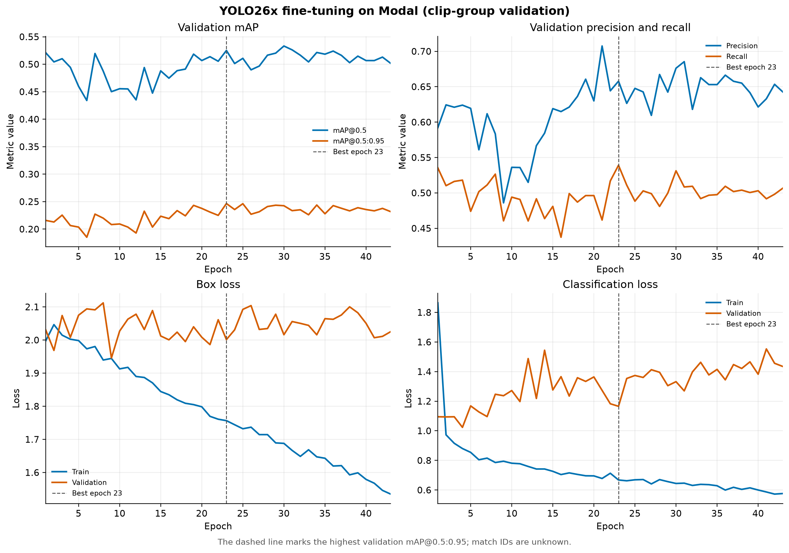
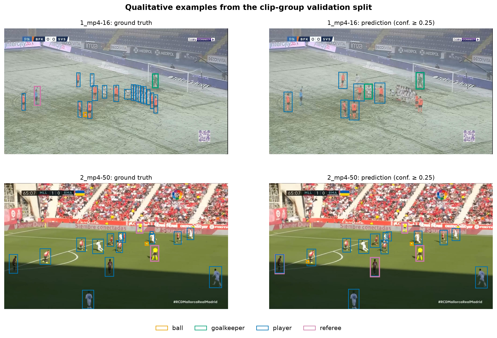
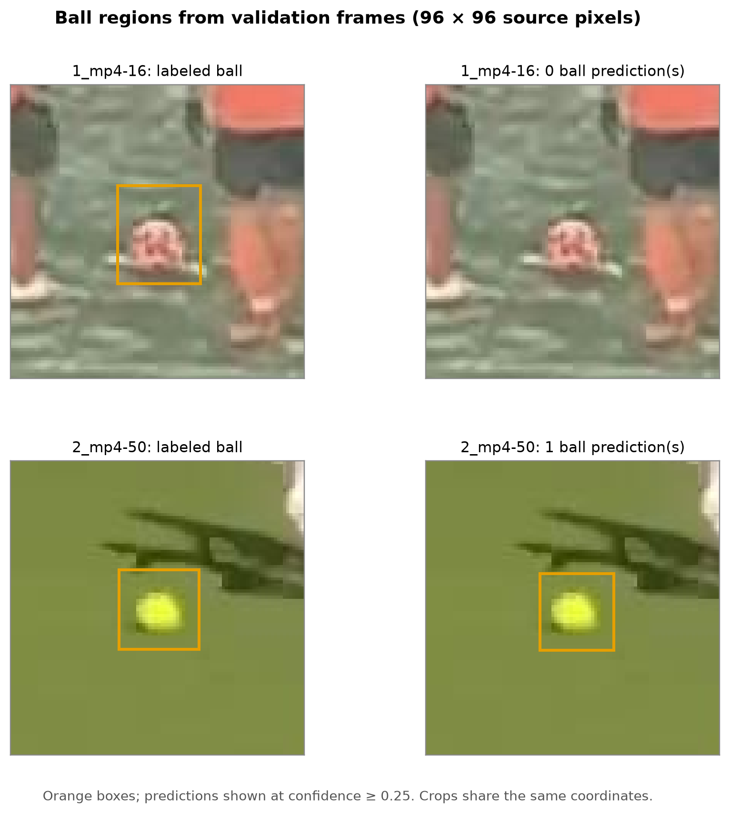

# Tài liệu báo cáo thực nghiệm — bước A: fine-tune bộ phát hiện

Tài liệu này ghi kết quả **đã chạy** ở bước A. Các hình trong `report/figures/` được tạo từ dữ liệu dẫn xuất, log huấn luyện và checkpoint thực tế bằng `scripts/make_report_figures.py`. Kết quả tiếp theo nằm ở [báo cáo B](BAO_CAO_BUOC_B.md) và [báo cáo C](BAO_CAO_BUOC_C.md); các bước D–F chưa được đo.

## 1. Đặt vấn đề và mục tiêu

Hệ thống gốc [football-analytics](https://github.com/alina-letzien/football-analytics) kết hợp phát hiện đối tượng, theo dõi, chia đội theo màu áo và phân tích bóng đá từ video. Bài tập lớn kế thừa pipeline và mã nguồn theo giấy phép MIT, đồng thời xây dựng bộ phát hiện bốn lớp (`ball`, `goalkeeper`, `player`, `referee`) được fine-tune trên dữ liệu bóng đá. Đây là đóng góp đã hoàn thành ở bước A; chia đội được nghiên cứu tiếp ở bước C, còn xuất CSV, heatmap, minimap và dashboard là các bước sau.

**Câu hỏi thực nghiệm A:** Có thể huấn luyện và kiểm tra một checkpoint YOLO26x bốn lớp trên tập ảnh bóng đá được chuẩn bị có kiểm soát hay không? Các chỉ số validation dưới đây trả lời câu hỏi về *tập hiện có*, chưa đo được khả năng tổng quát sang trận mới.

## 2. Dữ liệu và kiểm soát chất lượng

Nguồn là [detection-player, phiên bản 4](https://universe.roboflow.com/fsdm-olss1/detection-player/dataset/4), bản xuất YOLOv8, giấy phép **CC BY 4.0**; tên lớp trong `data.yaml` theo thứ tự ID là `ball`, `goalkeeper`, `player`, `referee`. Bản xuất có 2.329 file ảnh. Kiểm tra bằng `scripts/audit_dataset.py` phát hiện 239 bản sao ảnh theo hash, trong đó có 75 nội dung ảnh xuất hiện xuyên các tập, cùng 53 dòng nhãn lỗi. Vì vậy thí nghiệm dùng bản dẫn xuất tạo bởi `scripts/prepare_clip_split.py`: bỏ ảnh trùng hệt, loại 15 box diện tích bằng 0 và cắt 63 box vượt biên nhỏ về miền tọa độ hợp lệ. Bản ZIP gốc được giữ để truy xuất nguồn.

| Tập sau xử lý | Số ảnh | Ball | Goalkeeper | Player | Referee |
|---|---:|---:|---:|---:|---:|
| Train | 1.247 | 971 | 897 | 12.967 | 1.431 |
| Validation | 599 | 448 | 371 | 7.859 | 815 |
| Test | 244 | 240 | 244 | 244 | 270 |

Các số ở bốn cột cuối là **số box**, không phải số ảnh. Số ảnh sau xử lý là 2.090. Tập train có nhiều box `player` hơn rõ rệt; tập test `pelanty` có phân bố khác mạnh. Hình 1 dùng trục log ở biểu đồ box để vẫn nhìn thấy các lớp ít mẫu.


*Hình 1.* Số ảnh theo tập và số box theo lớp trong bản dữ liệu đã xử lý. Thống kê tính trực tiếp từ cặp ảnh/nhãn YOLO, không suy ra từ số ảnh trên trang Roboflow. File chất lượng in: [PDF](figures/dataset_distribution.pdf).

**Giới hạn chia dữ liệu:** Các tập được tách theo nhóm tên clip (`train`: Clipchamp, `3-_-2`, `bolhi`, `courtoi_1`; `validation`: `1`, `2`; `test`: `pelanty`). Kiểm tra hash cho thấy không còn ảnh giống hệt xuyên tập. Tuy nhiên không có ID trận đáng tin cậy, nên **chưa chứng minh được các tập độc lập theo trận**. Các frame gần nhau hoặc clip khác tên vẫn có thể đến từ một trận. Chỉ số validation phải được gọi là *kết quả tạm thời trên tập chia theo clip*, không dùng để khẳng định hiệu quả trên trận chưa thấy. Muốn đánh giá học thuật mạnh hơn cần xác định trận nguồn và chia lại theo trận, hoặc thu thập/gán nhãn một trận riêng làm holdout.

## 3. Thiết kế thí nghiệm A

| Thành phần | Thiết lập đã chạy |
|---|---|
| Kiến trúc/checkpoint khởi tạo | Ultralytics `yolo26x.pt` pretrained |
| Tác vụ | Object detection, bốn lớp |
| Môi trường huấn luyện | Modal, một GPU H100 |
| Ảnh đầu vào | `imgsz=640` |
| Batch | 8 |
| Số epoch yêu cầu | 50 |
| Early stopping | `patience=20`; dừng ở epoch 43 |
| Seed | 0, `deterministic=True` theo `args.yaml` |
| Optimizer | `auto` theo `args.yaml`; không gán tên optimizer khi log chưa xác nhận |
| Chọn checkpoint | `best.pt`; epoch 23 có mAP@0.5:0.95 validation cao nhất trong CSV |

Lệnh đã dùng:

```powershell
python -X utf8 -m modal run modal_train.py --dataset football_4class_clip_split --model yolo26x.pt --epochs 50 --imgsz 640 --batch 8 --name detection_player_full_v1
```

Đầu vào là dataset YOLO dẫn xuất và pretrained checkpoint. Đầu ra là `best.pt`, `args.yaml`, `results.csv` trên Modal Volume `football-training-runs:/detection_player_full_v1`, đã tải bản sao về `runs/modal/detection_player_full_v1/` trên máy. Checkpoint có SHA-256 `77e9593c2a758ed31bedb2a3b993157fa4f1c01f9044f844d1ee798151501417`. Log và checkpoint không được đưa vào Git vì dung lượng; để tái tạo hình cần các file này cùng dataset dẫn xuất.

## 4. Thước đo và kết quả

Precision đo tỷ lệ box dự đoán dương tính là đúng, còn recall đo tỷ lệ đối tượng gán nhãn được phát hiện. AP là diện tích dưới đường precision–recall của một lớp; mAP là trung bình AP qua các lớp. `mAP@0.5` dùng ngưỡng IoU 0,5; `mAP@0.5:0.95` lấy trung bình qua các ngưỡng IoU từ 0,5 đến 0,95 theo bước 0,05. Định nghĩa theo [tài liệu Ultralytics về detection metrics](https://docs.ultralytics.com/guides/yolo-performance-metrics/). Khi diễn giải precision/recall tổng hợp cần nhớ đây là chỉ số tổng hợp do Ultralytics xuất, không phải số riêng của lớp bóng.

| Run đã thực hiện | Tập | Epoch checkpoint | Precision | Recall | mAP@0.5 | mAP@0.5:0.95 | AP ball |
|---|---|---:|---:|---:|---:|---:|---|
| Full fine-tune `yolo26x.pt` | Validation chia theo clip | 23/43 | 0,65779 | 0,53901 | 0,52506 | 0,24651 | Chưa đo |

Các giá trị là dòng epoch 23 trong `results.csv`, khớp với metadata `train_metrics` của `best.pt`. Chúng **không phải chỉ số test**. Không dùng số này để kết luận cải thiện so với model gốc, vì chưa chạy đánh giá baseline trên cùng tập và cùng quy tắc đo.



*Hình 2.* mAP, precision/recall và loss theo epoch từ `results.csv`. Đường đứt đánh dấu epoch 23. mAP trên validation dao động, trong khi loss train giảm; đây là dấu hiệu cần kiểm tra thêm về tính ổn định, phân bố clip và chất lượng nhãn. Chỉ từ đường cong này chưa thể kết luận nguyên nhân hay định lượng mức overfitting. File chất lượng in: [PDF](figures/training_curves.pdf).

## 5. Phân tích định tính và lỗi



*Hình 3.* Hai frame thuộc validation. Mỗi hàng so sánh nhãn nguồn (trái) và dự đoán `best.pt` (phải) tại confidence `0,25`, IoU NMS `0,45`, ảnh suy luận 640 pixel. Màu cam: ball; xanh lá: goalkeeper; xanh dương: player; hồng: referee. Đây là ví dụ minh họa, **không thay thế thống kê toàn tập**. File chất lượng in: [PDF](figures/qualitative_examples.pdf).



*Hình 4.* Cắt 96 × 96 pixel từ hai frame của Hình 3, cùng tọa độ cho nhãn và dự đoán. Ở frame `1_mp4-16` có quả bóng trong nhãn nhưng không có dự đoán bóng vượt confidence 0,25 ở vùng cắt; ở `2_mp4-50` có dự đoán trùng vùng bóng. Đây là quan sát ở **hai frame**, chưa phải recall/AP của lớp ball. File chất lượng in: [PDF](figures/ball_detail.pdf).

Frame `1_mp4-16` có điều kiện tuyết và cầu thủ nhỏ/che nhau; frame `2_mp4-50` có cảnh sáng và bóng vàng rõ hơn. Sự khác nhau này gợi ý cần kiểm tra theo điều kiện hình ảnh, nhưng không đủ để quy nguyên nhân bỏ sót cho tuyết. Một số nhãn cầu thủ/trọng tài trong Hình 3 cũng cần kiểm tra thủ công trước khi gán lỗi hoàn toàn cho mô hình. Nên lập bảng kiểm lỗi trên mẫu frame có chọn lọc: bóng quá nhỏ, che khuất, nhầm cầu thủ/trọng tài, nhãn thiếu/sai, và khác góc quay. Cần giữ nguyên quy tắc lấy mẫu và ghi cả số trường hợp để tránh chọn ví dụ thuận mắt.

## 6. So sánh ba thiết lập ở bước B

Ba thiết lập pretrained gốc, `freeze=10` và fine-tune toàn bộ đã được đánh giá bằng cùng giao thức. Kết quả, AP từng lớp, các hình so sánh và giới hạn ánh xạ nhãn COCO được trình bày trong [báo cáo bước B](BAO_CAO_BUOC_B.md). Không trộn chỉ số Ultralytics từ bảng bước A với số COCOeval của bước B vì giao thức đo khác nhau.

## 7. Giới hạn và phần cần hoàn thiện

1. Không có ID trận; nguy cơ rò rỉ ngữ cảnh giữa các clip chưa được loại trừ bằng chứng cứ.
2. Test hiện tại chỉ gồm nhóm `pelanty`, khác phân bố train/validation; [báo cáo bước B](BAO_CAO_BUOC_B.md) ghi chỉ số test như kết quả thăm dò riêng.
3. Dữ liệu nguồn có nhãn lỗi và có thể có nhãn thiếu/sai dù các tọa độ không hợp lệ đã được xử lý. Cần kiểm tra thủ công chất lượng lớp ball.
4. AP ball đã có ở bước B, nhưng chưa có khoảng tin cậy hoặc lặp lại nhiều seed. Không nên suy diễn chênh lệch nhỏ giữa các run nếu chưa kiểm tra độ biến thiên.
5. [Bước C](BAO_CAO_BUOC_C.md) đã đo chia đội với box gán nhãn; chưa có phép đo end-to-end cho tracking, kiểm soát bóng, quãng đường, tốc độ, heatmap hoặc minimap.

## 8. Cách tái tạo hình và ghi nguồn

```powershell
python -X utf8 scripts/make_report_figures.py
```

Script yêu cầu `datasets/football_4class_clip_split`, `runs/modal/detection_player_full_v1/results.csv` và `weights/best.pt`; cần `matplotlib`, `Pillow`, `numpy`, `ultralytics`. Ảnh PNG và PDF được xuất vào `report/figures/`, kèm `figure_metadata.json` ghi số liệu, tên frame, ngưỡng confidence và SHA-256 checkpoint. Hình định tính cần GPU local theo cấu hình hiện tại của script (`device=0`). Nếu không có GPU local, đổi sang `device="cpu"` rồi tạo lại; kết quả dự đoán có thể khác nhẹ giữa môi trường/phần mềm.

**Nguồn cần ghi trong báo cáo:** mã gốc [alina-letzien/football-analytics](https://github.com/alina-letzien/football-analytics) (MIT); dataset [FSDM, detection-player v4](https://universe.roboflow.com/fsdm-olss1/detection-player/dataset/4) (CC BY 4.0, ghi tên tác giả/dataset, phiên bản, URL và mọi thay đổi nhãn/split); [Ultralytics documentation: model training](https://docs.ultralytics.com/modes/train/) và [detection metrics](https://docs.ultralytics.com/guides/yolo-performance-metrics/). Khi viết cơ sở lý thuyết về theo dõi, có thể trích [Zhang và cộng sự, “ByteTrack: Multi-Object Tracking by Associating Every Detection Box”](https://arxiv.org/abs/2110.06864). Không gán một paper riêng cho repo gốc khi chưa xác minh được.

## 9. Dàn ý toàn báo cáo

1. **Đặt vấn đề:** bài toán và yêu cầu đầu ra; phạm vi bốn lớp và phân tích video bóng đá.
2. **Cơ sở lý thuyết:** detection/YOLO, AP–mAP, tracking/ByteTrack, phân cụm màu áo, phép đo vị trí–tốc độ.
3. **Phân tích dự án gốc:** sơ đồ pipeline, model pretrained, luồng dữ liệu, điểm kế thừa và giới hạn đã kiểm chứng.
4. **Thiết kế cải tiến:** dữ liệu và split; fine-tune; dự kiến cải thiện chia đội, CSV, heatmap/minimap, dashboard.
5. **Thực nghiệm và đánh giá:** giao thức, cấu hình, bảng ba thiết lập khi hoàn tất, hình 1–4, phân tích lỗi, đánh giá downstream.
6. **Kết luận:** kết quả thực đo, giới hạn và công việc tiếp theo.
