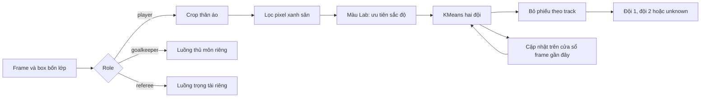
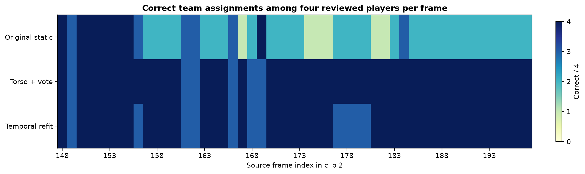

# Báo cáo thực nghiệm bước C — chia đội theo màu áo

## 1. Mục tiêu và phần kế thừa

Pipeline gốc trong [football-analytics](https://github.com/alina-letzien/football-analytics) dùng KMeans để gom màu áo của cầu thủ thành hai đội. Bản mã trước cải tiến (`src/team_assigner_baseline.py`) lấy trung bình màu BGR của nửa trên box từ các frame đầu, rồi giữ kết quả theo track ID. Nếu cảnh đổi ánh sáng, màu nền sân lẫn vào áo hoặc một track được gán sai ban đầu, kết quả có thể không cập nhật. Bước C kiểm tra việc lấy màu áo vững hơn, bỏ phiếu ngắn hạn và phân cụm lại theo thời gian.

Thủ môn và trọng tài được tách khỏi tập cầu thủ trước khi gom màu: `YOLODetector` trả `goalkeepers`/`referees` riêng; `ByteTrackTracker` giữ role riêng; `FootballAnalyzer` vẽ riêng và chỉ đưa `players` vào `TeamAssigner`. Thủ môn hiện **chưa được gán ID đội** khi không có cách xác định đội đáng tin cậy từ màu áo; quyền kiểm soát bóng của thủ môn cũng chưa gán cho đội. Đây là giới hạn được giữ rõ ràng để tránh coi áo thủ môn là áo cầu thủ. Khi dùng checkpoint COCO gốc, model không có nhãn thủ môn/trọng tài riêng; cần dùng checkpoint bốn lớp từ bước B để role được dự đoán.



## 2. Thiết kế thay đổi

| Cấu hình | Lấy màu | Phân cụm | Ổn định nhãn |
|---|---|---|---|
| Mã gốc | Trung bình BGR trên nửa trên box | Fit một lần từ 10 frame đầu | Cache theo track ID |
| Thân áo + bỏ phiếu | Median vùng thân áo giữa box; bỏ pixel xanh sân; Lab với trọng số sáng thấp | Fit một lần | Bỏ phiếu tối đa 7 quan sát tin cậy |
| Đầy đủ theo thời gian | Cùng cách lấy màu mới | Fit lại mỗi 30 frame trên cửa sổ 90 frame; ghép tâm mới với ID cũ theo khoảng cách nhỏ nhất | Bỏ phiếu tối đa 7 quan sát |

Mọi cấu hình dùng hai cụm, `random_state=42`, ngưỡng tin cậy 0,15. Nếu không đủ hai màu phân biệt, bản mới trả `unknown` thay vì đoán đội 1. Pixel xanh sân được lọc bằng hue/saturation trong HSV; có thể tắt `suppress_pitch_green` khi đội mặc áo xanh. Bản mới giảm trọng số sáng trong đặc trưng Lab để áo đỏ dưới nắng và áo trắng trong bóng râm ít bị gom chung theo độ sáng. Cập nhật tâm cụm giữ thứ tự đội bằng hoán vị có tổng khoảng cách đến tâm trước nhỏ nhất; đây là **giữ ID cụm màu**, không phải re-ID cầu thủ.

## 3. Dữ liệu và quy trình kiểm tra thủ công

Thí nghiệm chia đội ban đầu được thực hiện trước khi có video demo của người dùng, dùng [detection-player v4](https://universe.roboflow.com/fsdm-olss1/detection-player/dataset/4) (CC BY 4.0), nhóm clip `2` thuộc validation của bản dẫn xuất. Chọn một bản xuất cho mỗi số frame, xử lý thứ tự frame 0–197 để tạo ngữ cảnh thời gian. Frame 147 dùng **hiệu chuẩn tên hai đội** (`white`, `red_black`) và không tính điểm; đánh giá 50 frame liên tiếp 148–197. Hai bộ áo trắng và đỏ/đen được kiểm tra trực quan trên các [sheet crop](figures/team_review_sheet_1.jpg).

Mỗi frame đánh giá chọn bốn box cầu thủ gán nhãn sẵn trong dataset: hai mẫu rõ và hai mẫu bổ sung ở vị trí/kích thước khác. Bộ chọn ban đầu dựa trên màu gợi ý; sau đó toàn bộ 202 crop (gồm hai mẫu hiệu chuẩn) được nhìn lại, **sửa tay 5 nhãn gợi ý sai** và lưu trong [`team_review_verified.csv`](data/team_review_verified.csv). Có 95 mẫu áo trắng và 105 mẫu áo đỏ/đen để tính điểm. Các sheet [1](figures/team_review_sheet_1.jpg), [2](figures/team_review_sheet_2.jpg), [3](figures/team_review_sheet_3.jpg), [4](figures/team_review_sheet_4.jpg), [5](figures/team_review_sheet_5.jpg), [6](figures/team_review_sheet_6.jpg), [7](figures/team_review_sheet_7.jpg), [8](figures/team_review_sheet_8.jpg), [9](figures/team_review_sheet_9.jpg), [10](figures/team_review_sheet_10.jpg), [11](figures/team_review_sheet_11.jpg) cho phép xem lại lựa chọn và nhãn.

Thí nghiệm dùng **box GT từ dataset** và nối ID tạm giữa hai frame kề bằng IoU ≥ 0,25. Như vậy điểm đo tập trung vào **chia đội khi đã có box/role**, không bao gồm lỗi YOLO hay ByteTrack của video chạy thật. Cùng 200 mẫu được đưa qua cả ba cấu hình. ID đội 1/2 được ánh xạ một lần bằng hai mẫu frame 147, không tối ưu lại trên 50 frame đánh giá. `unknown` tính là sai. Chỉ số thứ nhất là số mẫu cầu thủ được chia đúng / 200; chỉ số thứ hai là số frame có **cả bốn** mẫu đúng / 50.

Trong 50 frame còn có 42 box `goalkeeper` và 42 box `referee` theo nhãn dataset, được loại khỏi đầu vào KMeans. Con số này xác nhận quy trình lọc theo role ở mức nhãn, **không phải** độ chính xác phát hiện role của YOLO.

## 4. Kết quả và ablation

| Cấu hình | Mẫu đúng / 200 | Tỉ lệ mẫu đúng | Frame đúng cả 4 / 50 | Tỉ lệ frame | Lần cập nhật cụm |
|---|---:|---:|---:|---:|---:|
| Mã gốc | 116 | 58,0% | 8 | 16,0% | 0 |
| Thân áo + bỏ phiếu | **194** | **97,0%** | **44** | **88,0%** | 0 |
| Đầy đủ theo thời gian | 189 | 94,5% | 39 | 78,0% | 6 |


*Hình C1.* Điểm trên cùng 50 frame validation có nhãn đội kiểm tra trực quan. Bản in: [PDF](figures/team_assignment_comparison.pdf). Dữ liệu chi tiết từng mẫu và dự đoán của ba cấu hình ở [`team_assignment_predictions.csv`](data/team_assignment_predictions.csv); tổng hợp máy đọc được ở [`team_assignment_summary.json`](data/team_assignment_summary.json).



*Hình C2.* Mỗi ô biểu diễn số mẫu chia đội đúng trong bốn mẫu đã kiểm tra của một frame. Hình cho thấy đoạn sau frame 156 khó với mã gốc và năm lỗi tăng thêm của cấu hình cập nhật cụm ở một số frame. Bản in: [PDF](figures/team_assignment_frame_heatmap.pdf).

**Diễn giải:** thay đổi vùng áo và đặc trưng màu đem lại phần lớn cải thiện so với mã gốc trên tập chọn này. Thêm phân cụm theo thời gian **giảm 5 mẫu đúng** và giảm 5 frame đúng trọn vẹn so với cấu hình thân áo + bỏ phiếu. Các lỗi bổ sung của cấu hình thời gian xuất hiện ở mẫu áo đỏ/đen thuộc frame 156 và 177–180. Vì đoạn 50 frame dùng một cặp áo ổn định, việc làm mới cụm có thể kéo tâm cụm theo các cảnh trước và gây lệch; đây là giả thuyết từ quan sát, chưa được kiểm định nhân quả. Chức năng cập nhật vẫn hữu ích để thử trên video dài có thay đổi ánh sáng, nhưng kết quả hiện tại **không chứng minh nó cải thiện độ chính xác**.

## 5. Giới hạn

1. 50 frame liên tiếp và nhiều cầu thủ xuất hiện lặp lại; 200 mẫu không phải 200 quan sát độc lập. Không suy ra độ tin cậy thống kê từ tỉ lệ này.
2. Mẫu được chọn có chủ đích để nhìn rõ áo và có box `player`; kết quả không đại diện tất cả box, các tình huống che khuất nặng hay đội mặc áo gần giống nhau.
3. Bộ dữ liệu không có ID đội, nên nhãn `white`/`red_black` do kiểm tra hình ảnh; các box chồng người vẫn có thể gây tranh cãi và được giữ trong CSV để xem lại.
4. Đây là validation dùng để phát triển phương pháp. Chưa có video/trận độc lập hoặc phép đo chạy video end-to-end, và dataset chưa xác minh độc lập theo trận như [báo cáo A](BAO_CAO_BUOC_A.md) đã nêu.
5. Lọc pixel xanh có thể loại mất áo xanh; cần tắt hoặc thay ngưỡng theo màu áo của trận mới. Người xem, ban huấn luyện và cầu thủ ngoài sân cũng có thể lọt vào lớp `player`.
6. Thủ môn được tách role nhưng chưa gán vào đội, nên thống kê quyền kiểm soát bóng của đội trong pha thủ môn cầm bóng còn thiếu.

## 6. Tái tạo và cách chạy video khi có file

```powershell
python -X utf8 scripts/prepare_team_review.py
# Sau khi đối chiếu sheet, file nhãn đã chốt nằm tại report/data/team_review_verified.csv.
python -X utf8 scripts/evaluate_team_assignment.py
python -m pytest -q -m "not slow"

# Chạy video với checkpoint bốn lớp đã tải ở bước B:
$env:YOLO_MODEL_PATH = "runs/modal/detection_player_freeze10_v1/weights/best.pt"
python main.py
```

Lệnh video cần `input/DFL-Scoutingfeed.mp4`; clip người dùng đã chạy kiểm tra nhưng **chưa có điểm end-to-end** vì không có nhãn tham chiếu đầy đủ. Đầu ra là video có box `P`, `GK`, `R`, cùng thống kê pipeline; các nhãn đội 1/2 là ID cụm màu, phải đối chiếu màu áo của trận. Nếu thay checkpoint hoặc video, xóa/chọn thư mục stub khác để không dùng lại tracks cũ. Các nguồn phương pháp chung và giấy phép mã/dữ liệu được ghi trong [báo cáo A](BAO_CAO_BUOC_A.md).

## 7. Kiểm tra lỗi nhầm cầu thủ/trọng tài trên clip thật

Trên đoạn 450 frame của `2e57b9_0.mp4`, nhãn YOLO theo từng frame đổi qua lại trên cùng track: trước sửa có 297 quan sát lớp `referee` thuộc 23 track ID từng được gán vai trò này. Xem thủ công các frame 78, 408 và 420 thấy track áo xanh bị ghi `R`, còn trọng tài áo vàng có frame bị ghi `P`. Đây là **ví dụ lỗi được quan sát**, không phải bộ nhãn GT đầy đủ.

Quy tắc mới lấy vùng thân áo trong box người, tính tỷ lệ pixel vàng theo HSV và yêu cầu vùng quần có pixel tối; điều kiện quần giúp tránh ghi một thủ môn mặc cả bộ vàng thành trọng tài. Quy tắc chỉ kích hoạt khi kiểu trang phục này hiếm trong clip, có một số dự đoán `referee` cùng kiểu và không chiếm phần lớn như áo của một đội. Mỗi quan sát được bỏ phiếu cùng tối đa bốn quan sát gần của cùng track. Trên clip này, 70/1.354 mẫu kiểm tra màu và quần thỏa điều kiện (5,17%); sau sửa có 308 quan sát `referee` thuộc 7 track ID và 477 quan sát đổi vai trò. Các con số mô tả **đầu ra thuật toán**, không chứng minh 477 nhãn được sửa đúng. Xem thủ công frame 78/420 cho thấy hai cầu thủ áo xanh chuyển `R→P`; frame 141 cho thấy trọng tài áo vàng chuyển `P→R`, còn thủ môn áo vàng/quần vàng không được chuyển thành `R`.

Điều kiện có thể tái tạo: lấy một mẫu mỗi 5 frame; pixel áo vàng có HSV hue 28–34, saturation ≥60, value ≥70; tỷ lệ vàng trong crop thân áo ≥0,20 và tỷ lệ pixel có value <70 trong crop quần ≥0,08. Chỉ bật khi có ít nhất 50 quan sát mẫu, ít nhất 8 mẫu thỏa, tỷ lệ kiểu trang phục ≤8%, ít nhất 3 mẫu cùng kiểu được model gán `referee`, và tỷ lệ nhãn `referee` trong nhóm này ≥ max(10%, hai lần tỷ lệ nhãn `referee` toàn clip). Các ngưỡng này được chọn theo clip phát triển; không phải ngưỡng tổng quát đã kiểm định.

Clip khác có đội mặc màu gần vàng không thỏa điều kiện nên giữ nhãn model. Vẫn có nguy cơ nhầm khi thủ môn hoặc đội thứ ba mặc màu tương tự, crop áo quá nhỏ, ánh sáng đổi hoặc track ID chuyển người. Cần gán nhãn thủ công một tập frame độc lập để tính precision/recall cho vai trò trước khi dùng quy tắc này như một cải tiến độ chính xác đã xác nhận.

Tham khảo triển khai: [scikit-learn `KMeans`](https://scikit-learn.org/stable/modules/generated/sklearn.cluster.KMeans.html) và [OpenCV `cvtColor` cho BGR–HSV/Lab](https://docs.opencv.org/5.0/main_modules/imgproc_color_conversions.html). Trọng số sáng 0,15, ngưỡng lọc xanh và lịch cập nhật cụm là lựa chọn thực nghiệm trong dự án này, không phải tham số được các tài liệu trên khuyến nghị.
