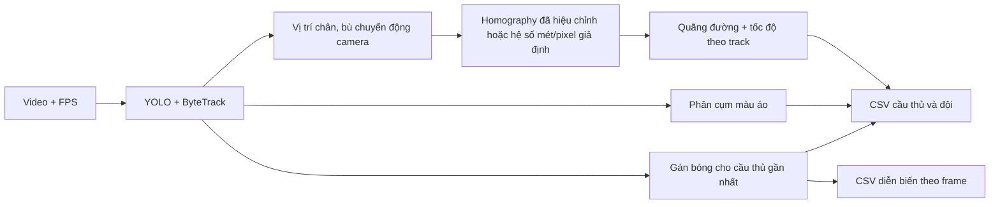

# Bước D — Xuất thống kê cầu thủ và đội ra CSV

## 1. Mục tiêu và trạng thái dữ liệu

Đầu vào của bước D là **video có FPS thực**, tracks theo từng frame, nhãn cụm áo ở bước C, vị trí chân sau khi trừ dịch chuyển camera, và cầu thủ gần bóng được pipeline gán cho từng frame. Đầu ra là CSV cầu thủ, đội, diễn biến gán bóng theo frame và JSON ghi phương pháp đo. Hiện người dùng chưa cung cấp video demo. Dataset `detection-player` v4 là ảnh/nhãn phát hiện, không có FPS, track ID thật, nhãn quyền kiểm soát bóng hay hiệu chỉnh mặt sân. Vì vậy **chưa có số đo thực nghiệm về mét, km/h, hoặc % kiểm soát bóng trên video**; không dùng các ảnh validation để giả lập một trận đấu.

## 2. Phương pháp tính



- Mỗi bước chuyển động **giữa hai frame liên tiếp có cùng track ID** cộng khoảng cách Euclid giữa hai vị trí. Không nội suy quãng đường khi ID biến mất; sau khi xuất hiện lại, tổng quãng đường của ID đó vẫn được giữ nhưng đoạn khuất không được cộng. Tốc độ tại frame là trung bình quãng đường mỗi frame của tối đa `frame_window=5` bước gần nhất, nhân FPS và 3,6 để ra km/h. FPS lấy từ video đầu vào, không lấy hằng số 30 khi video có FPS hợp lệ.
- Nếu có bốn cặp điểm hiệu chỉnh sân do người dùng cung cấp, tọa độ dùng homography và đơn vị mét. Nếu không có, mã gốc dùng **0,1 m/pixel giả định**. Cả cột `distance_m_estimate` và `speed_kmh_estimate` lúc đó chỉ là ước tính theo hệ số này, không được trình bày như quãng đường/sức chạy thực tế. Bước này không tự hiệu chỉnh sân.
- `has_ball` là quy tắc quả bóng được phát hiện nằm gần chân cầu thủ nhất dưới ngưỡng pixel; đây là **gán bóng theo hình ảnh**, không phải nhãn kiểm soát bóng do chuyên gia xác nhận. Mỗi frame được đếm cho đội 1, đội 2 hoặc `unknown` (0). Thủ môn chưa được gán đội và chưa thể nhận quyền kiểm soát bóng trong quy tắc hiện tại.
- `%_video = số frame được gán / tổng frame × 100`. `%_assigned_frames` của đội 1/2 dùng mẫu số là tổng frame được gán cho hai đội. Số `unknown` giúp thấy tỷ lệ video không giải thích được. `possession_seconds_estimate = số frame / FPS` chỉ là thời gian gán theo frame, không xác nhận một pha kiểm soát bóng liên tục.

## 3. Tệp xuất

Chạy `python main.py` với video trong `input/DFL-Scoutingfeed.mp4` và checkpoint bốn lớp. Với output mặc định, hệ thống tạo:

| Tệp | Nội dung chính |
|---|---|
| `output/analysis_players.csv` | Mỗi track cầu thủ/thủ môn: role, team ID, frame đầu/cuối, số frame nhìn thấy, quãng đường, tốc độ trung bình/cao nhất, số frame và % được gán bóng |
| `output/analysis_teams.csv` | Đội 1, đội 2 và `unknown`: số người được track, tổng quãng đường quan sát, tốc độ trung bình quan sát, số frame và % gán bóng |
| `output/analysis_possession_timeline.csv` | Mỗi frame: thời gian, track ID đang được gán bóng và team ID |
| `output/analysis_csv_metadata.json` | FPS, số frame, phương pháp tọa độ, hệ số mét/pixel, định nghĩa các giới hạn |

Đội 1/2 chỉ là **ID cụm màu áo**, chưa phải tên đội. Track ID không phải nhận dạng cầu thủ bền vững: ID có thể đổi sau che khuất; số `tracked_people` là số ID chứ không phải số người duy nhất. Nếu track bị gán nhiều đội, CSV cầu thủ chọn đội xuất hiện nhiều hơn; hòa phiếu thành `unknown`. CSV đội phân bổ từng bước quãng đường theo nhãn đội của frame tương ứng.

## 4. Cách chạy và hình cho báo cáo

```powershell
$env:YOLO_MODEL_PATH = "runs/modal/detection_player_freeze10_v1/weights/best.pt"
python main.py
python scripts/plot_csv_report.py output/analysis
```

Lệnh thứ hai tạo `output/analysis_report_chart.png` và `.pdf`: tỷ lệ frame gán bóng của hai đội/unknown và 10 track có quãng đường ước tính lớn nhất. Đây là **thống kê mô tả từ video đã chạy**, không phải biểu đồ độ chính xác so với nhãn chuẩn. Chú thích hình nên ghi tên video, FPS, thời lượng, checkpoint, tình trạng hiệu chỉnh sân và tỷ lệ `unknown`. Không đưa hình này vào phần *đánh giá độ chính xác* nếu chưa có nhãn tham chiếu độc lập.

## 5. Kiểm chứng và giới hạn

Kiểm thử đơn vị dùng chuỗi track giả lập có khoảng cách biết trước: đường đi 5 m + 5 m phải cho 10 m, 2 frame gán bóng ở FPS=2 phải cho 1 giây và 50% của video 4 frame. Kiểm thử còn bao gồm frame `unknown`, track thủ môn và khoảng trống track (không cộng quãng đường qua đoạn mất dấu). Đây là kiểm chứng **công thức và định dạng xuất**, không phải độ chính xác trên bóng đá thật.

Để có số liệu báo cáo thực nghiệm sau này, cần video có FPS đáng tin cậy, kiểm tra khoảng 30–50 frame thủ công về bóng/đội/ID, và nếu muốn diễn giải theo mét thật thì cung cấp bốn cặp điểm sân để hiệu chỉnh. Lỗi phát hiện bóng, ID switch, camera bù chuyển động chưa chuẩn, phối cảnh và cầu thủ bị che sẽ đi thẳng vào CSV. Quãng đường theo track là đường quan sát được, thường thấp hơn quãng đường thật khi mất dấu; nhiễu vị trí có thể làm nó cao hơn ở đoạn nhìn thấy.
