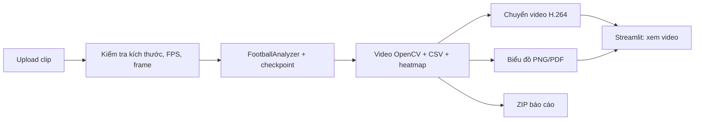

# Bước F — Dashboard Streamlit

> Nhật ký thực nghiệm tại thời điểm bước F. Checkpoint và giao diện hiện tại đã thay đổi; dùng [README](../README.md) và [hướng dẫn chạy](../docs/HUONG_DAN_TEST_BAO_CAO.md) để sử dụng hệ thống mới nhất.

## 1. Mục tiêu và thiết kế

Dashboard trong `dashboard.py` có một luồng **Phân tích video**: tải clip hoặc nhập đường dẫn cục bộ, chạy checkpoint `freeze=10`, tự chọn GPU CUDA nếu khả dụng, xem video H.264, biểu đồ, heatmap, bảng CSV và tải PDF/ZIP. Tab “Kết quả cho báo cáo” đã được bỏ khỏi giao diện; tư liệu học thuật vẫn nằm trong thư mục `report/` của repo.

Dashboard chỉ là lớp giao diện quanh `FootballAnalyzer` trong `main.py`; các bước YOLO, ByteTrack, chia đội, gán bóng, đo chuyển động, CSV và heatmap vẫn dùng cùng mã như khi chạy `python main.py`. **Modal đã dùng để train YOLO; dashboard suy luận trên máy đang mở Streamlit.** Checkpoint `runs/modal/detection_player_freeze10_v1/weights/best.pt` được cố định cho luồng này vì có điểm validation cao nhất trong ba thiết lập ở [báo cáo B](BAO_CAO_BUOC_B.md).

Luồng chạy tự áp dụng bộ lọc người ngoài sân và ổn định nhãn `player`/`referee` sau ByteTrack, trước KMeans chia đội. Quy tắc màu áo vàng/quần tối chỉ kích hoạt khi clip có bằng chứng hỗ trợ; nếu thiếu, giữ nhãn model. JSON trong ZIP ghi phương pháp và số quan sát đổi nhãn. Đây là ước đoán vai trò, chưa có nhãn kiểm tra độc lập cho toàn clip.



Mỗi lần upload được lưu vào thư mục ID ngẫu nhiên `output/dashboard_jobs/<id>/`; tên tệp do ứng dụng đặt, không dùng tên đường dẫn từ trình duyệt. Từng job có stub riêng và chạy với `read_from_stub=False`, tránh lấy nhầm track của video khác. Dashboard cho upload tối đa 500 MB; tệp lớn hơn có thể đọc qua đường dẫn cục bộ. Người dùng chọn tối đa 450 frame ở 1280×720 hoặc 900 frame với độ phân giải tự giảm vì pipeline đọc toàn bộ frame vào RAM. Server mặc định chỉ nghe `127.0.0.1` theo `.streamlit/config.toml`.

## 2. Đầu vào và đầu ra

| Thành phần | Đầu vào | Đầu ra / khi nào có thể sai |
|---|---|---|
| Upload | MP4/MOV/AVI/MKV có frame và FPS hợp lệ | Từ chối tệp hỏng, vượt giới hạn hoặc thiếu FPS |
| Suy luận | Clip + checkpoint có sẵn + CPU/GPU | Phụ thuộc chất lượng detection/tracking; CPU có thể chậm |
| Video trình duyệt | MP4 do OpenCV xuất | Chuyển H.264/yuv420p bằng `imageio-ffmpeg` để trình duyệt phát được |
| Thống kê và biểu đồ | CSV và heatmap từ pipeline | Bảng theo track có thời gian nhìn thấy, dịch chuyển trên ảnh, frame gán bóng, chuyền/nhận ứng viên. Pixel không phải mét; chuyền ứng viên chưa xác minh thành công |
| Tải báo cáo | ZIP gồm CSV, JSON phương pháp, PNG/PDF | Video lớn và clip upload không nằm trong ZIP |

## 3. Hình kiểm tra kỹ thuật


**Chú thích đề xuất:** Frame đầu ra từ pipeline trên **ba ảnh validation 148–150** của [FSDM `detection-player` v4](https://universe.roboflow.com/fsdm-olss1/detection-player/dataset/4) (CC BY 4.0), ghép thành clip kỹ thuật 640×360 với **FPS giả định 10**. Hình xác nhận video có box, team ID, thống kê và minimap, rồi được chuyển sang H.264. Đây **không phải video demo của người dùng**, không dùng số tốc độ/quãng đường/kiểm soát bóng từ clip này để báo cáo hiệu năng. Có [bản PDF](figures/dashboard_pipeline_smoke.pdf).

Các hình độ chính xác detector và chia đội vẫn nằm ở [báo cáo B](BAO_CAO_BUOC_B.md) và [báo cáo C](BAO_CAO_BUOC_C.md); dashboard chỉ hiển thị lại, không tự tính điểm đánh giá từ video chưa có nhãn GT. Pass map ứng viên được mô tả riêng trong [báo cáo G](BAO_CAO_BUOC_G.md).

## 4. Cách chạy trên Windows

Từ thư mục repo:

```powershell
python -m pip install -r requirements.txt
python -m streamlit run dashboard.py
```

Mở `http://127.0.0.1:8501`. Nếu không thấy checkpoint đã tải từ Modal, kiểm tra hai đường dẫn `runs/modal/detection_player_freeze10_v1/weights/best.pt` và `runs/modal/detection_player_full_v1/weights/best.pt`. Tệp ZIP của mỗi job được lưu cùng thư mục job; hình và báo cáo A–G nằm trong `report/`.

## 5. Kiểm chứng và giới hạn

- Kiểm thử đơn vị xác nhận upload không dùng tên tệp do người dùng đặt làm đường dẫn, kiểm tra metadata video, chuyển MP4V sang H.264 và ZIP loại video dung lượng lớn.
- `Streamlit AppTest` chạy trang khởi động với 0 exception, 2 tab và widget upload. Lệnh server được kiểm tra chạy cục bộ trên `127.0.0.1`.
- Smoke test ba frame validation chạy qua checkpoint `freeze=10` trên CPU và tạo video H.264, CSV, PNG/PDF, metadata. Đây là kiểm chứng khả năng chạy và cấu trúc đầu ra, không phải thí nghiệm đánh giá trên trận thật.
- Đã chạy kiểm tra tích hợp trên clip 450 frame và xem lại PDF/video đầu ra. Clip chưa có nhãn tham chiếu độc lập, vì vậy chưa suy ra độ chính xác của tracking, gán bóng hoặc đường chuyền từ kết quả này.

Tài liệu API giao diện: [Streamlit `st.file_uploader`](https://docs.streamlit.io/develop/api-reference/widgets/st.file_uploader), [`st.video`](https://docs.streamlit.io/develop/api-reference/media/st.video) và [`st.download_button`](https://docs.streamlit.io/develop/api-reference/widgets/st.download_button).
