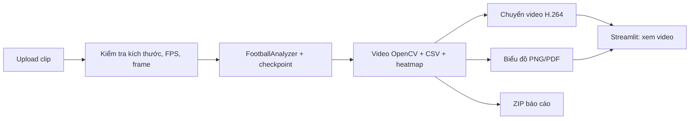

# Bước F — Dashboard Streamlit

## 1. Mục tiêu và thiết kế

Dashboard trong `dashboard.py` có hai tab:

1. **Phân tích video:** tải một clip, chọn checkpoint (`freeze=10` mặc định), chọn CPU/GPU khả dụng, chạy pipeline hiện có, xem video H.264, biểu đồ, heatmap, bảng CSV và tải ZIP báo cáo.
2. **Kết quả cho báo cáo:** xem hình thí nghiệm A–E và sơ đồ G (giả lập), rồi tải gói báo cáo A–G, đề cương, hình kèm nguồn.

Dashboard chỉ là lớp giao diện quanh `FootballAnalyzer` trong `main.py`; các bước YOLO, ByteTrack, chia đội, gán bóng, đo chuyển động, CSV và heatmap vẫn dùng cùng mã như khi chạy `python main.py`. **Modal đã dùng để train YOLO; dashboard mặc định chạy suy luận trên máy đang mở Streamlit.** Checkpoint `runs/modal/detection_player_freeze10_v1/weights/best.pt` được chọn trước vì có điểm validation cao nhất trong ba thiết lập ở [báo cáo B](BAO_CAO_BUOC_B.md). Có thể chọn checkpoint fine-tune toàn bộ hoặc model gốc nếu tệp đã có trên máy; model gốc không tách riêng thủ môn/trọng tài.



Mỗi lần upload được lưu vào thư mục ID ngẫu nhiên `output/dashboard_jobs/<id>/`; tên tệp do ứng dụng đặt, không dùng tên đường dẫn từ trình duyệt. Từng job có stub riêng và chạy với `read_from_stub=False`, tránh lấy nhầm track của video khác. Dashboard hiện giới hạn 100 MB, 450 frame và 1280×720 vì pipeline đọc toàn bộ frame vào RAM. Server mặc định chỉ nghe `127.0.0.1` theo `.streamlit/config.toml`.

## 2. Đầu vào và đầu ra

| Thành phần | Đầu vào | Đầu ra / khi nào có thể sai |
|---|---|---|
| Upload | MP4/MOV/AVI/MKV có frame và FPS hợp lệ | Từ chối tệp hỏng, vượt giới hạn hoặc thiếu FPS |
| Suy luận | Clip + checkpoint có sẵn + CPU/GPU | Phụ thuộc chất lượng detection/tracking; CPU có thể chậm |
| Video trình duyệt | MP4 do OpenCV xuất | Chuyển H.264/yuv420p bằng `imageio-ffmpeg` để trình duyệt phát được |
| Thống kê và biểu đồ | CSV và heatmap từ pipeline | Thống kê mô tả, không phải điểm độ chính xác; quãng đường chỉ ước tính nếu chưa hiệu chỉnh sân |
| Tải báo cáo | ZIP gồm CSV, JSON phương pháp, PNG/PDF | Video lớn và clip upload không nằm trong ZIP |

## 3. Hình kiểm tra kỹ thuật


**Chú thích đề xuất:** Frame đầu ra từ pipeline trên **ba ảnh validation 148–150** của [FSDM `detection-player` v4](https://universe.roboflow.com/fsdm-olss1/detection-player/dataset/4) (CC BY 4.0), ghép thành clip kỹ thuật 640×360 với **FPS giả định 10**. Hình xác nhận video có box, team ID, thống kê và minimap, rồi được chuyển sang H.264. Đây **không phải video demo của người dùng**, không dùng số tốc độ/quãng đường/kiểm soát bóng từ clip này để báo cáo hiệu năng. Có [bản PDF](figures/dashboard_pipeline_smoke.pdf).

Các hình độ chính xác detector và chia đội vẫn nằm ở [báo cáo B](BAO_CAO_BUOC_B.md) và [báo cáo C](BAO_CAO_BUOC_C.md); dashboard chỉ hiển thị lại, không tự tính điểm đánh giá từ video chưa có nhãn GT. Pass map ứng viên được mô tả riêng trong [báo cáo G](BAO_CAO_BUOC_G.md).

## 4. Cách chạy trên Windows

Từ thư mục repo:

```powershell
python -m pip install -r requirements.txt
python -m streamlit run dashboard.py
```

Mở `http://127.0.0.1:8501`. Nếu không thấy checkpoint đã tải từ Modal, kiểm tra hai đường dẫn `runs/modal/detection_player_freeze10_v1/weights/best.pt` và `runs/modal/detection_player_full_v1/weights/best.pt`. Tệp ZIP của mỗi job được lưu cùng thư mục job; hình và báo cáo A–G nằm trong `report/`.

## 5. Kiểm chứng và giới hạn

- Kiểm thử đơn vị xác nhận upload không dùng tên tệp do người dùng đặt làm đường dẫn, kiểm tra metadata video, chuyển MP4V sang H.264 và ZIP loại video dung lượng lớn.
- `Streamlit AppTest` chạy trang khởi động với 0 exception, 2 tab và widget upload. Lệnh server được kiểm tra chạy cục bộ trên `127.0.0.1`.
- Smoke test ba frame validation chạy qua checkpoint `freeze=10` trên CPU và tạo video H.264, CSV, PNG/PDF, metadata. Đây là kiểm chứng khả năng chạy và cấu trúc đầu ra, không phải thí nghiệm đánh giá trên trận thật.
- Chưa có video demo thực của người dùng; vì vậy chưa có nhận xét về trải nghiệm xem video dài, chất lượng tracking thực tế, FPS suy luận hoặc tính chính xác của số liệu dashboard. UI chưa được chụp màn hình bằng trình duyệt do công cụ điều khiển trình duyệt trong phiên này dừng ở bước kiểm tra URL; ảnh trên là frame đầu ra pipeline đã kiểm tra trực quan.

Tài liệu API giao diện: [Streamlit `st.file_uploader`](https://docs.streamlit.io/develop/api-reference/widgets/st.file_uploader), [`st.video`](https://docs.streamlit.io/develop/api-reference/media/st.video) và [`st.download_button`](https://docs.streamlit.io/develop/api-reference/widgets/st.download_button).
