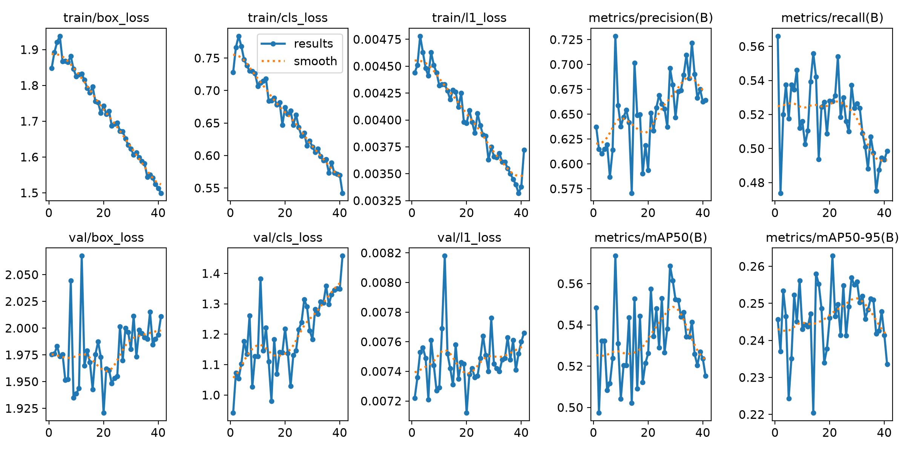
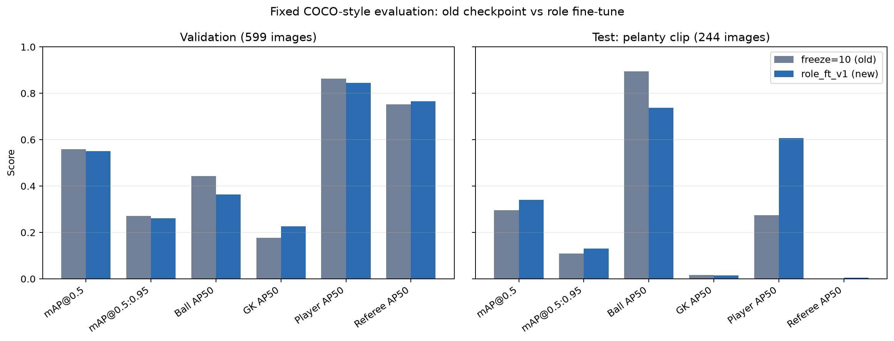
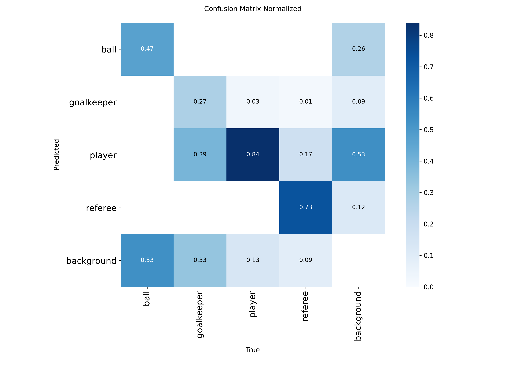

# Thí nghiệm bổ sung: fine-tune sửa nhầm vai trò

## 1. Mục tiêu

Thí nghiệm này xử lý lỗi mô hình cũ nhầm `player`, `goalkeeper` và `referee` trên video có góc quay hoặc màu áo khác dữ liệu ban đầu. Đây là cập nhật **một detector bốn lớp dùng chung cho mọi video**, không phải chế độ hay luật vá riêng cho một video.

## 2. Dữ liệu và chống rò rỉ

Bản Roboflow `football-role-correction` v1 gồm 60 frame do người dùng gán đầy đủ bốn lớp: 51 box `ball`, 38 `goalkeeper`, 669 `player`, 55 `referee`. Script [`merge_role_correction_dataset.py`](../scripts/merge_role_correction_dataset.py) kiểm tra cặp ảnh–nhãn, ID lớp, tọa độ YOLO và tên lớp rồi thêm toàn bộ 60 frame vào **tập train**. Validation 599 ảnh và test 244 ảnh của thí nghiệm trước được giữ nguyên. Sau gộp, train có 1.307 ảnh; valid 599; test 244.

Không chia ngẫu nhiên 60 frame gần nhau sang validation/test vì như vậy sẽ rò rỉ nội dung cùng video. Giấy phép trong bản xuất Roboflow là `Private`; ảnh và nhãn không được commit. Tập 60 frame chỉ dùng làm dữ liệu thích nghi miền và kiểm tra chẩn đoán, không phải tập kiểm thử độc lập.

## 3. Cấu hình huấn luyện

- Khởi tạo: `detection_player_freeze10_v1/weights/best.pt`.
- Fine-tune toàn bộ (`freeze=0`) trên Modal H100; Ultralytics 8.4.163.
- `imgsz=640`, batch 8, seed 0, tối đa 50 epoch, patience 20.
- Early stopping ở epoch 41; checkpoint tốt nhất ở epoch 21.
- Run: `detection_player_role_ft_full_v1`.
- SHA-256 `best.pt`: `35f82408cbf424a7c1ad3acb2abb561778179c66d985daa29d7226e842c8fde9`.

Lệnh tái tạo dataset và huấn luyện (sau khi đã giải nén hai dataset cục bộ):

```powershell
python scripts/merge_role_correction_dataset.py datasets/football_4class_clip_split datasets/role_review_screen_recording_yolov8 datasets/football_4class_role_ft_v1
python -m modal volume put football-dataset .\datasets\football_4class_role_ft_v1 /football_4class_role_ft_v1
python -X utf8 -m modal run modal_train.py --dataset football_4class_role_ft_v1 --model /runs/detection_player_freeze10_v1/weights/best.pt --epochs 50 --imgsz 640 --batch 8 --name detection_player_role_ft_full_v1 --freeze 0
```



*Hình 1. Loss và metric theo epoch do Ultralytics xuất. Checkpoint triển khai lấy từ epoch tốt nhất, không lấy epoch cuối.*

## 4. Đánh giá độc lập cùng giao thức

Hai checkpoint được đánh giá bằng cùng giao thức COCO-style: ảnh 640, confidence suy luận 0,001, NMS IoU 0,7, COCOeval `maxDets=100`. Precision/recall là macro bốn lớp ở confidence 0,25 và IoU 0,5. File số liệu đầy đủ: [`role_ft_evaluation_summary.json`](data/role_ft_evaluation_summary.json).

| Split | Model | Precision | Recall | mAP@0.5 | mAP@0.5:0.95 | AP50 ball | AP50 GK | AP50 player | AP50 referee |
|---|---|---:|---:|---:|---:|---:|---:|---:|---:|
| Valid 599 ảnh | freeze=10 cũ | 0,5936 | 0,5780 | 0,5591 | 0,2709 | 0,4426 | 0,1775 | 0,8639 | 0,7524 |
| Valid 599 ảnh | role_ft_v1 | 0,5473 | 0,5745 | 0,5501 | 0,2614 | 0,3629 | 0,2271 | 0,8449 | 0,7657 |
| Test 244 ảnh (`pelanty`) | freeze=10 cũ | 0,3259 | 0,4412 | 0,2963 | 0,1094 | 0,8942 | 0,0169 | 0,2741 | 0,0001 |
| Test 244 ảnh (`pelanty`) | role_ft_v1 | 0,2254 | 0,3987 | 0,3411 | 0,1303 | 0,7383 | 0,0142 | 0,6063 | 0,0056 |



*Hình 2. So sánh cùng giao thức. Model mới tăng AP thủ môn trên validation và tăng mAP trên test, nhưng giảm AP bóng và precision; không có chỉ số nào được tuyên bố là cải thiện đồng thời toàn diện.*

Trên validation, AP50 thủ môn tăng 0,0496 và AP50 trọng tài tăng 0,0133; mAP50 giảm 0,0090, AP50 bóng giảm 0,0796. Trên test miền `pelanty`, mAP50 tăng 0,0447 và AP50 player tăng 0,3321, nhưng precision macro và AP50 bóng giảm. Test này chỉ thuộc một clip penalty có phân bố khác train/valid, vì vậy không đại diện cho mọi trận.

## 5. Kiểm tra chẩn đoán trên 60 frame đã train

| Model | Precision | Recall | mAP@0.5 | mAP@0.5:0.95 | AP50 ball | AP50 GK | AP50 player | AP50 referee |
|---|---:|---:|---:|---:|---:|---:|---:|---:|
| freeze=10 cũ | 0,5547 | 0,5611 | 0,5278 | 0,2211 | 0,1895 | 0,2211 | 0,9014 | 0,7992 |
| role_ft_v1 | 0,7753 | 0,7982 | 0,7943 | 0,4001 | 0,3400 | 0,9348 | 0,9652 | 0,9372 |

Mức tăng lớn trên 60 frame xác nhận model đã học miền video được sửa nhãn, đặc biệt với thủ môn. Tuy nhiên đây là **đánh giá lại tập train**, có thiên lệch lạc quan và không được dùng làm kết quả tổng quát hóa. Dữ liệu gốc nằm trong [`role_ft_diagnostic_training_frames.json`](data/role_ft_diagnostic_training_frames.json).



*Hình 3. Ma trận nhầm lẫn Ultralytics của lượt fine-tune; dùng để chẩn đoán lớp, không thay thế đánh giá trên video hoặc trận độc lập.*

## 6. Quyết định triển khai và giới hạn

Dashboard chuyển sang `detection_player_role_ft_full_v1` vì mục tiêu trực tiếp là giảm nhầm vai trò trên miền video mới, trong khi mAP validation chỉ thay đổi nhỏ và mAP test tăng. Đổi lại, AP bóng và precision có thể giảm; cần xem video đầu ra và tỷ lệ frame phát hiện bóng trong PDF. Không tuyên bố model đã giải quyết hoàn toàn lỗi thủ môn.

Bước đánh giá tiếp theo nên là gán 100–300 frame từ **một hoặc nhiều trận khác**, giữ nguyên từng trận trong một split, rồi báo confusion matrix `player`–`goalkeeper`, precision/recall từng lớp và độ ổn định track. Chỉ dữ liệu độc lập như vậy mới xác nhận khả năng áp dụng cho video chưa thấy.
