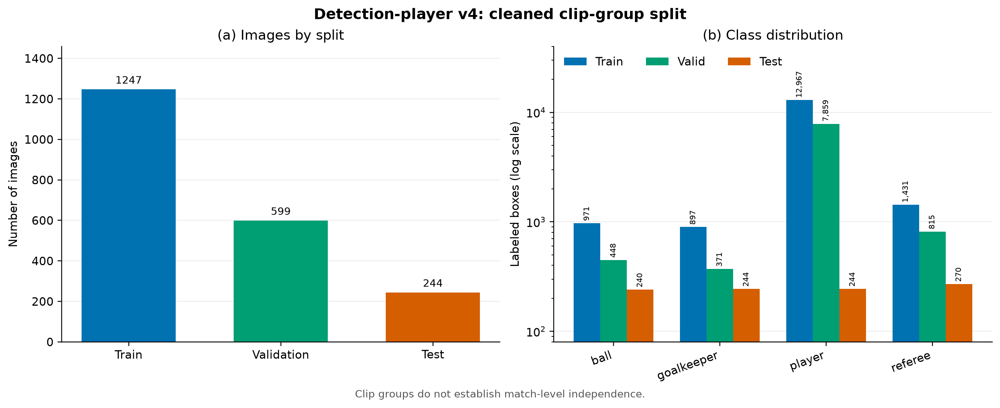
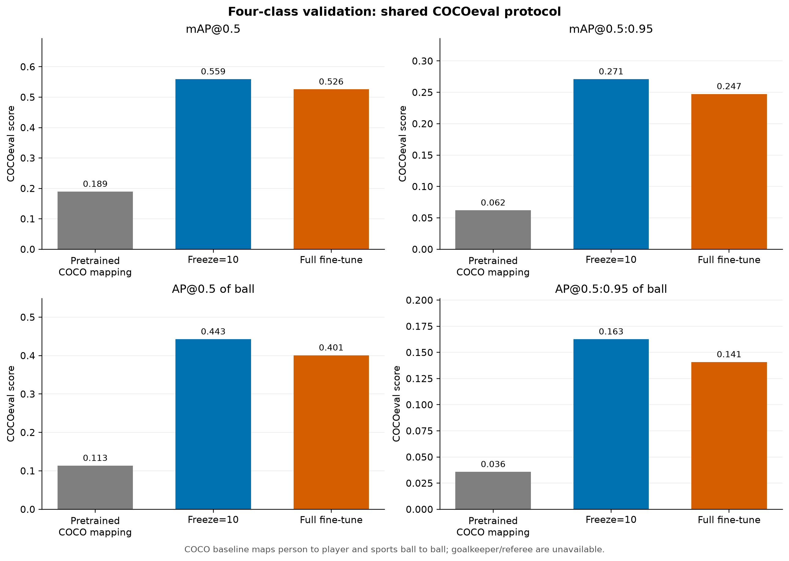
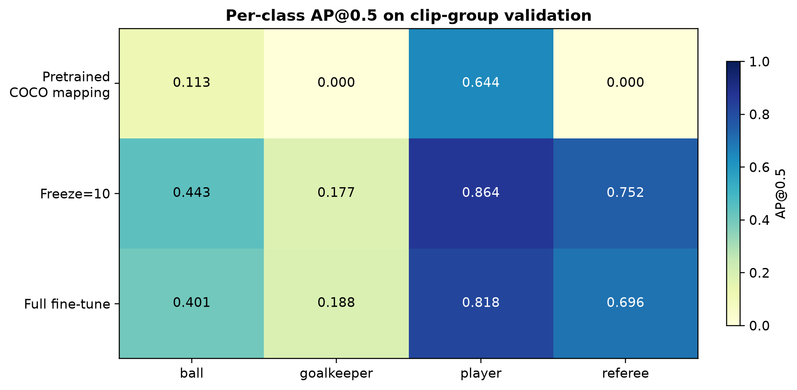
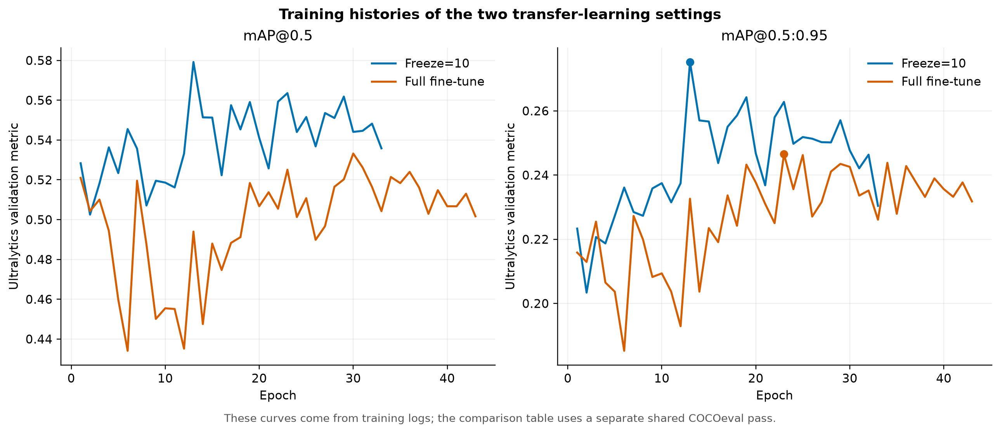
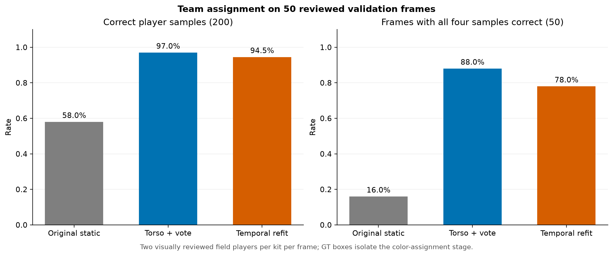
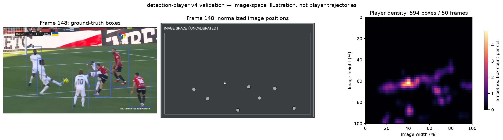
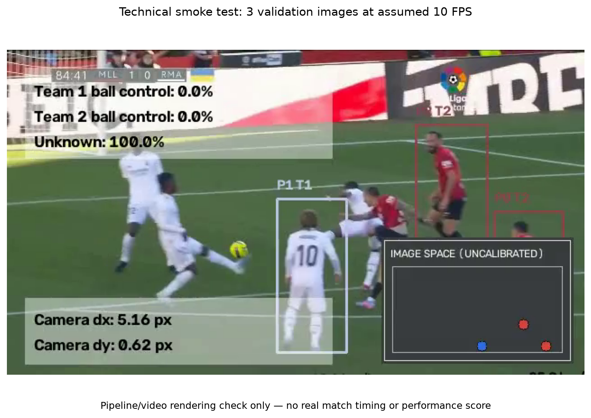
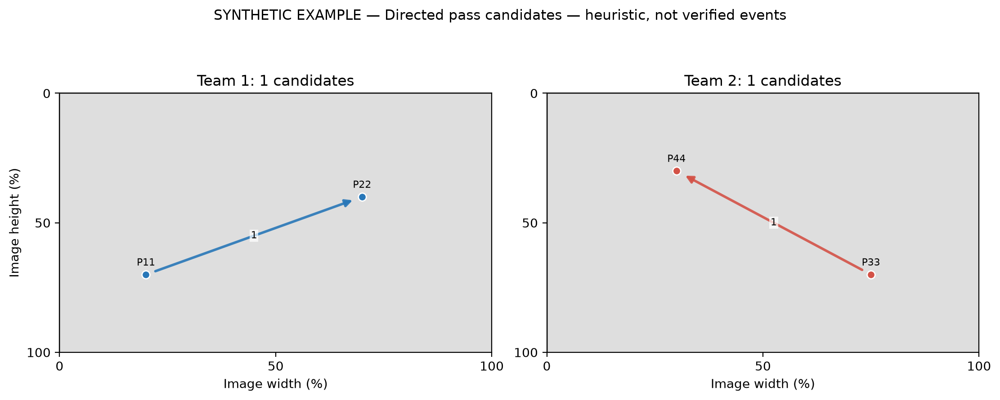

# Phát triển hệ thống phân tích bóng đá từ video bằng thị giác máy tính

> Báo cáo tổng hợp tại thời điểm trước lượt fine-tune sửa vai trò và các lần thử video sau đó. Xem [thí nghiệm vai trò](BAO_CAO_FINE_TUNE_VAI_TRO.md) và [README](../README.md) để biết cấu hình hiện tại.

**Báo cáo bài tập lớn.** Người thực hiện, lớp, môn học, giảng viên và ngày nộp: *sinh viên tự điền theo yêu cầu môn học*. Các số đo dưới đây là kết quả đã chạy trên dữ liệu nêu rõ; không thay bằng số từ một trận chưa được quan sát.

## Tóm tắt

Đề tài phát triển dự án mã nguồn mở [football-analytics](https://github.com/alina-letzien/football-analytics) (MIT) thành hệ thống phát hiện bốn lớp `ball`, `goalkeeper`, `player`, `referee`, phân tích màu áo, xuất thống kê CSV và trực quan hóa qua Streamlit. Bộ dữ liệu [FSDM detection-player v4](https://universe.roboflow.com/fsdm-olss1/detection-player/dataset/4) (CC BY 4.0) được kiểm tra, làm sạch và chia theo nhóm clip trước khi huấn luyện YOLO26x trên Modal. Trên 599 ảnh validation, ba thiết lập pretrained, `freeze=10` và fine-tune toàn bộ đạt mAP@0.5 lần lượt **0,1895; 0,5591; 0,5257** theo cùng giao thức COCOeval. Trên 200 mẫu cầu thủ của 50 frame validation đã kiểm tra thủ công, cách chia đội gốc đúng **58,0%**; cải tiến vùng thân áo kết hợp bỏ nền xanh và bỏ phiếu theo track đúng **97,0%**. Bản có phân cụm lại theo thời gian đúng **94,5%**, thấp hơn bản không phân cụm lại trên đoạn này. CSV, heatmap, minimap, dashboard và bản đồ ứng viên đường chuyền đã chạy kiểm tra kỹ thuật. Do chưa có video demo độc lập, các chỉ số chuyển động, quyền kiểm soát bóng và đường chuyền chưa được đánh giá như kết quả trên trận thật.

**Từ khóa:** bóng đá; phát hiện đối tượng; YOLO26x; ByteTrack; phân cụm màu áo; thị giác máy tính.

## 1. Đặt vấn đề

Video bóng đá chứa nhiều đối tượng nhỏ, chuyển động nhanh và thường bị che khuất. Một pipeline hữu ích phải phát hiện và theo dõi cầu thủ, phân biệt hai đội, gán bóng, sau đó trình bày kết quả với đơn vị và giới hạn rõ ràng. Repo gốc đã cung cấp luồng YOLO → ByteTrack → KMeans theo màu áo → gán bóng → ước tính tốc độ và quãng đường. Tuy nhiên, checkpoint pretrained theo nhãn COCO không tách riêng thủ môn và trọng tài; mã gốc không cung cấp một thí nghiệm bốn lớp trên bộ dữ liệu được kiểm soát trong bài làm này. Đề tài kế thừa mã theo MIT và bổ sung thí nghiệm có thể tái lập cùng các đầu ra hỗ trợ kiểm tra.

Mục tiêu nghiên cứu gồm: (i) so sánh ba cách dùng YOLO26x trên bốn lớp bóng đá; (ii) kiểm tra việc cải thiện gán đội theo màu áo; (iii) xây dựng CSV, heatmap, minimap, giao diện web và bản đồ ứng viên chuyền bóng. Phạm vi không bao gồm tái nhận dạng cầu thủ qua các lần mất dấu hoặc tự hiệu chỉnh sân.

## 2. Cơ sở lý thuyết

**Phát hiện đối tượng.** YOLO dự đoán lớp, độ tin cậy và khung bao trên ảnh. Trong thí nghiệm này, [YOLO26x của Ultralytics](https://docs.ultralytics.com/models/yolo26/) được khởi tạo từ checkpoint pretrained. Với một dự đoán và nhãn chuẩn, `IoU = diện tích giao / diện tích hợp`. Precision đo tỷ lệ dự đoán đúng trong các dự đoán dương tính; recall đo tỷ lệ nhãn chuẩn được phát hiện. AP là diện tích dưới đường precision–recall cho một lớp. mAP@0.5 lấy trung bình AP ở IoU 0,5; mAP@0.5:0.95 lấy trung bình qua các ngưỡng 0,50–0,95, bước 0,05 và qua bốn lớp theo [định nghĩa metric của Ultralytics](https://docs.ultralytics.com/guides/yolo-performance-metrics/). Báo cáo ghi rõ bộ tính điểm COCOeval dùng trong so sánh để tránh trộn với chỉ số sinh trong quá trình train.

**Theo dõi và chia đội.** [ByteTrack](https://arxiv.org/abs/2110.06864) liên kết box giữa các frame thành track ID. ID có thể thay đổi khi cầu thủ bị che hoặc rời khung hình. KMeans phân cụm đặc trưng màu áo thành hai nhóm; tên nhóm không tự mang nghĩa đội thật. Phần cải tiến lấy màu ở thân áo, giảm ảnh hưởng nền cỏ, dùng không gian màu Lab và bỏ phiếu theo các quan sát của track. Thủ môn và trọng tài được đưa qua nhánh role riêng, không dùng làm mẫu phân cụm cầu thủ. Phiên bản tái phân cụm có thể thích ứng theo thời gian nhưng cũng có thể làm nhãn dao động; vì vậy được đánh giá riêng.

**Chỉ số video.** Điểm chân của box được bù chuyển động camera rồi chuyển sang tọa độ sân bằng bốn cặp điểm hiệu chỉnh thủ công, nếu có. Khi không có hiệu chỉnh, hệ số 0,1 m/pixel kế thừa từ mã gốc chỉ tạo *ước tính phụ thuộc giả định*. Quãng đường của một track là tổng khoảng cách giữa những frame liên tiếp có cùng ID; tốc độ theo cửa sổ năm bước được đổi sang km/h bằng FPS. Quyền kiểm soát bóng trong mã là quy tắc gán bóng gần chân cầu thủ theo frame, không phải nhãn sự kiện do chuyên gia xác nhận.

## 3. Dự án gốc và đóng góp

| Thành phần | Kế thừa từ repo MIT | Phần phát triển trong bài làm |
|---|---|---|
| Video và tracking | YOLO pretrained, ByteTrack, bù camera, gán bóng | Định tuyến bốn role từ checkpoint mới, sửa cộng quãng đường qua frame liên tiếp |
| Chia đội | KMeans màu áo | Đặc trưng thân áo, giảm nền cỏ, phiếu theo track, thử tái phân cụm |
| Dữ liệu và học máy | Hướng dẫn train chung | Audit nhãn/trùng ảnh, chia theo clip, train Modal, so sánh ba thiết lập |
| Đầu ra | Video gắn chú thích | CSV có metadata, heatmap/minimap, Streamlit, ZIP báo cáo, ứng viên pass |

Repo gốc được ghi nguồn trong README và trong tài liệu này. Bộ dữ liệu có giấy phép **CC BY 4.0**, độc lập với giấy phép MIT của mã; khi tái sử dụng hình từ dataset cần ghi FSDM, tên dataset, phiên bản, URL và các bước xử lý đã thực hiện.

## 4. Dữ liệu và thiết kế thực nghiệm

Bản xuất YOLOv8 của `detection-player` v4 có **2.329 file ảnh**. Audit phát hiện **239 ảnh trùng nội dung**, trong đó **75 hash ảnh xuất hiện ở hơn một tập**; có **53 dòng nhãn lỗi**. Bản dẫn xuất loại ảnh trùng, loại 15 box có diện tích bằng 0 và cắt 63 box vượt biên nhỏ về miền tọa độ hợp lệ. Bốn ID lớp theo thứ tự `ball`, `goalkeeper`, `player`, `referee`. Số file ảnh sau xử lý là **2.090**; đây là số file của bản xuất đã xử lý, **không phải số ảnh gốc trước augmentation** vì provenance của từng biến thể không đủ để xác minh. [Hướng dẫn dataset](../docs/DATASET_GUIDE.md) nêu cách tải và kiểm tra.

| Tập | Ảnh | Box bóng | Box thủ môn | Box cầu thủ | Box trọng tài |
|---|---:|---:|---:|---:|---:|
| Train | 1.247 | 971 | 897 | 12.967 | 1.431 |
| Validation | 599 | 448 | 371 | 7.859 | 815 |
| Test | 244 | 240 | 244 | 244 | 270 |



*Hình 1.* Số file ảnh và số box sau làm sạch. Số box cầu thủ áp đảo các lớp còn lại. Nguồn ảnh và nhãn: FSDM, `detection-player` v4, CC BY 4.0; biểu đồ do nhóm tạo từ bản dẫn xuất.

Train gồm các nhóm clip `Clipchamp`, `3-_-2`, `bolhi`, `courtoi_1`; validation gồm `1`, `2`; test gồm `pelanty`. Hash giống hệt không còn giao nhau sau xử lý. **Không có ID trận đáng tin cậy**, nên chia theo clip không chứng minh được độc lập theo trận. Test chỉ thuộc một nhóm penalty có phân bố khác train/validation. Validation được dùng chọn checkpoint; kết quả test là kiểm tra miền hẹp, không đại diện cho bóng đá nói chung.

Ba thiết lập xuất phát từ `yolo26x.pt`: pretrained nguyên bản; đóng băng 10 lớp đầu (`freeze=10`); fine-tune toàn bộ. Hai run huấn luyện trên **Modal H100**, ảnh 640, batch 8, seed 0, tối đa 50 epoch, early stopping `patience=20`. Run freeze dừng ở epoch 33 và chọn best epoch 13; run toàn bộ dừng epoch 43 và chọn best epoch 23. Phiên bản Ultralytics trong đánh giá là **8.4.163**. Kết quả chọn từ `best.pt`, không lấy epoch cuối.

Đánh giá ba checkpoint trên cùng 599 ảnh validation bằng `pycocotools COCOeval` cho bounding box, `maxDets=100`; suy luận confidence 0,001, NMS IoU 0,7, `imgsz=640`. Precision/recall là macro bốn lớp ở confidence ≥0,25, ghép tham lam với IoU ≥0,5. Baseline COCO ánh xạ `person → player`, `sports ball → ball`, không sinh hai lớp thủ môn/trọng tài; vì thế mAP bốn lớp của baseline bị giới hạn bởi khác hệ nhãn. So sánh trực tiếp nhất là hai mô hình fine-tune. Mỗi thiết lập train một seed, chưa có khoảng tin cậy giữa nhiều lần chạy. Giao thức và JSON đầy đủ nằm trong [`comparison_b_summary.json`](data/comparison_b_summary.json).

## 5. Kết quả và thảo luận

### 5.1. Phát hiện bốn lớp

| Thiết lập | Precision | Recall | mAP@0.5 | mAP@0.5:0.95 | AP@0.5 bóng |
|---|---:|---:|---:|---:|---:|
| Pretrained gốc | 0,2278 | 0,2467 | 0,1895 | 0,0620 | 0,1135 |
| Đóng băng `freeze=10` | **0,5936** | **0,5780** | **0,5591** | **0,2709** | **0,4426** |
| Fine-tune toàn bộ | 0,5815 | 0,5630 | 0,5257 | 0,2473 | 0,4008 |

*Bảng 3.* Kết quả trên validation 599 ảnh, cùng COCOeval và ngưỡng precision/recall nêu ở mục 4. AP bóng là AP@0.5 riêng lớp `ball`.



*Hình 2.* Các chỉ số validation từ cùng giao thức. `freeze=10` cao hơn fine-tune toàn bộ **0,0334 mAP@0.5** và **0,0418 AP@0.5 bóng** trên tập này; một seed không đủ kết luận ưu thế ổn định.



*Hình 3.* AP theo bốn lớp. Hai AP bằng 0 của baseline ở thủ môn/trọng tài phản ánh thiếu đầu ra tương ứng sau ánh xạ COCO. AP của `goalkeeper` trên validation vẫn thấp hơn nhiều lớp `player` và `referee`, nên cần kiểm tra ảnh và nhãn theo lớp.



*Hình 4.* Log của hai run Modal; epoch dừng và best epoch được ghi trong metadata. Biểu đồ hỗ trợ kiểm tra early stopping, không chứng minh nguyên nhân của chênh lệch metric.

Trên **test 244 ảnh của clip `pelanty`**, mAP@0.5 lần lượt là 0,1128; 0,2963; 0,2944, còn mAP@0.5:0.95 là 0,0362; 0,1094; 0,1151. AP@0.5 bóng tương ứng 0,0123; 0,8942; 0,3556. AP bóng rất cao ở run freeze nhưng chỉ trên miền penalty hẹp; các lớp khác biến động mạnh. Không dùng test này để chọn thêm checkpoint hay khẳng định khả năng tổng quát sang trận mới.

### 5.2. Chia đội theo màu áo

Đánh giá riêng bước C dùng **box GT**, nhằm cô lập lỗi chia đội khỏi lỗi detector. Lấy 50 frame liên tiếp 148–197 của nhóm clip `2` trong validation, bốn crop cầu thủ đã xem thủ công mỗi frame: tổng 200 mẫu, gồm 95 áo trắng và 105 áo đỏ–đen. Một frame trước đó chỉ hiệu chỉnh ánh xạ ID cụm → tên màu, không tính điểm. Trong 50 frame có 42 box thủ môn và 42 box trọng tài được tách khỏi tập đánh giá cầu thủ. Nhãn sai hoặc `unknown` đều tính là sai.

| Phương pháp | Mẫu đúng / 200 | Tỷ lệ đúng | Frame cả 4 mẫu đúng / 50 |
|---|---:|---:|---:|
| KMeans gốc | 116 | 58,0% | 8 |
| Thân áo + Lab + giảm nền xanh + phiếu track | **194** | **97,0%** | **44** |
| Như trên, thêm tái phân cụm theo thời gian | 189 | 94,5% | 39 |



*Hình 5.* Tỷ lệ đúng trên 200 crop được kiểm tra thủ công. Tái phân cụm sáu lần làm sai thêm năm crop trong đoạn này; vì vậy chức năng có trong mã nhưng không được báo cáo là cải thiện thực nghiệm. Các crop thuộc frame liền kề, có tương quan và chỉ thuộc một clip. Đây là độ đúng có điều kiện theo box GT, **chưa phải độ đúng đầu cuối của video**.

### 5.3. CSV, hình không gian, dashboard và pass map

Module CSV xuất thống kê theo track cầu thủ, theo đội, diễn biến gán bóng từng frame và JSON định nghĩa đơn vị. Heatmap đếm số lần quan sát điểm chân của `player` trên lưới 48×72; minimap thể hiện vị trí 2D. Khi không hiệu chỉnh sân, hình ghi rõ **tọa độ ảnh**; các cột mét và km/h dựa trên hệ số giả định. Dashboard Streamlit nhận video ngắn, chạy pipeline, hiển thị video H.264, hình, bảng CSV và ZIP báo cáo. Pass map dùng quy tắc chuyển quyền gán bóng cùng đội để tạo *ứng viên chưa xác minh*, không phải sự kiện chuyền đã gán nhãn.



*Hình 6.* Box GT trên frame 148 và mật độ của 594 box `player` trong 50 frame validation của FSDM `detection-player` v4, CC BY 4.0. Chưa có nhãn đội, ID thật hoặc tọa độ sân; heatmap là mật độ trên ảnh, không phải quãng đường hay chiến thuật.



*Hình 7.* Ảnh đầu ra của kiểm tra kỹ thuật từ ba ảnh validation ghép thành clip FPS giả định 10. Đây là kiểm tra việc tạo video và overlay, không phải trận demo của người dùng.



*Hình 8.* Hai ứng viên đường chuyền **giả lập** dùng để kiểm tra thuật toán và cách xuất hình. Mũi tên không được lấy từ video hoặc nhãn thật.

Để kiểm tra luồng dài hơn, 50 ảnh validation của clip `2` được ghép thành clip 640×360 ở **FPS giả định 25** rồi chạy checkpoint `freeze=10` qua pipeline CPU. Video trình duyệt, CSV, heatmap và ZIP đều được sinh tại `output/dashboard_jobs/dataset_demo50/`; mô tả nguồn/FPS nằm trong `dataset_demo_protocol.json`. Trên clip ghép này pipeline không gán bóng cho đội ở cả 50 frame và tạo **0 ứng viên pass**. Các ảnh nguồn không có FPS được xác nhận hay track ID chuẩn. Vì vậy các con số quãng đường, tốc độ, thời lượng kiểm soát bóng hoặc pass từ clip ghép **không được dùng làm kết quả khoa học**. Đây cũng là dấu hiệu cần đánh giá phát hiện bóng và quy tắc gán bóng trên video thật trước khi dùng các chức năng downstream.

## 6. Giới hạn tính hợp lệ

1. **Độc lập dữ liệu:** không có ID trận, chỉ kiểm soát clip và hash giống hệt; frame gần giống giữa các clip vẫn có thể gây rò rỉ ngữ cảnh.
2. **Nguồn ảnh:** không xác minh được số ảnh nguyên gốc trước augmentation; test chỉ một clip penalty nên phân bố lệch.
3. **Thống kê mô hình:** một seed/thiết lập, chưa có lặp thí nghiệm, khoảng tin cậy hoặc kiểm tra ý nghĩa thống kê. Baseline COCO thiếu hai lớp đầu ra.
4. **Đánh giá chia đội:** 200 crop từ 50 frame liền nhau và box GT, chưa đo lỗi tích lũy detector/tracker trên một trận độc lập.
5. **Đầu ra video:** chưa có video demo của người dùng, nhãn kiểm soát bóng/pass, FPS nguồn và hiệu chỉnh sân. CSV, minimap theo sân và pass map mới được xác minh về công thức, định dạng và khả năng chạy; chưa có độ chính xác ngoài thực tế.

## 7. Kết luận và hướng tiếp theo

Trên validation chia theo clip, huấn luyện bốn lớp cải thiện mAP@0.5 so với baseline COCO ánh xạ; `freeze=10` có điểm cao nhất trong hai run fine-tune đã chạy. Đặc trưng thân áo và bỏ phiếu theo track cải thiện rõ rệt độ đúng chia đội trong mẫu 50 frame đã kiểm tra, còn tái phân cụm theo thời gian làm giảm điểm trên cùng đoạn. Pipeline CSV, trực quan hóa và dashboard đã có bản triển khai chạy được và nêu rõ trạng thái hiệu chỉnh tọa độ. Kết luận chỉ áp dụng cho các tập và giao thức đã mô tả.

Để có báo cáo hiệu năng đầu cuối, bước tiếp theo là lấy video demo có nguồn/FPS rõ, gán nhãn 100–300 frame có ID trận hoặc video, giữ một trận hoàn toàn độc lập làm test, kiểm tra thủ công bóng–đội–track–pass, và hiệu chỉnh sân nếu cần số đo mét. Khi có nhiều trận, lặp lại train qua nhiều seed và báo cáo phân tán theo trận. Không cần thêm re-ID hoặc tự hiệu chỉnh sân vào phạm vi bài làm hiện tại.

## Tài liệu tham khảo

1. Alina Letzien, [football-analytics](https://github.com/alina-letzien/football-analytics), mã nguồn MIT, truy cập 27/10/2026. Repo gốc là nguồn mã, không gán một paper riêng khi chưa xác minh.
2. FSDM, [detection-player, phiên bản 4](https://universe.roboflow.com/fsdm-olss1/detection-player/dataset/4), Roboflow Universe, CC BY 4.0, truy cập 27/10/2026.
3. Ultralytics, [YOLO26 model documentation](https://docs.ultralytics.com/models/yolo26/), truy cập 27/10/2026.
4. Ultralytics, [YOLO performance metrics](https://docs.ultralytics.com/guides/yolo-performance-metrics/), truy cập 27/10/2026.
5. Y. Zhang và cộng sự, [ByteTrack: Multi-Object Tracking by Associating Every Detection Box](https://arxiv.org/abs/2110.06864), 2021.
6. scikit-learn, [KMeans API reference](https://scikit-learn.org/stable/modules/generated/sklearn.cluster.KMeans.html), truy cập 27/10/2026.
7. Streamlit, [API documentation](https://docs.streamlit.io/develop/api-reference), truy cập 27/10/2026.

## Phụ lục tái lập

```powershell
# Cài đặt và xem dataset đã tải vào datasets/football_4class_clip_split
python -m pip install -r requirements.txt
python scripts/audit_dataset.py datasets/football_4class_clip_split

# Train trên Modal, dùng tên run mới nếu cần chạy lại
python -X utf8 -m modal run modal_train.py --dataset football_4class_clip_split --model yolo26x.pt --epochs 50 --imgsz 640 --batch 8 --freeze 10 --name detection_player_freeze10_v1
python -X utf8 -m modal run modal_train.py --dataset football_4class_clip_split --model yolo26x.pt --epochs 50 --imgsz 640 --batch 8 --name detection_player_full_v1

# Chạy dashboard cục bộ; checkpoint lớn không được commit
python -m streamlit run dashboard.py

# Chạy kiểm thử nhanh
python -m pytest -q -m "not slow"
```

Các run đã hoàn thành và số liệu gốc nằm trong `report/data/` cùng các báo cáo bước A–G. Dataset, checkpoint và video lớn được loại khỏi Git. Script `scripts/make_dataset_demo50.py` tái tạo clip kiểm tra kỹ thuật khi có dataset và checkpoint cục bộ; không dùng nó để suy ra hiệu năng trên trận thật.
